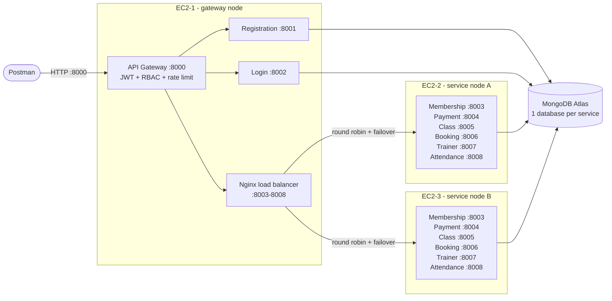

# FitCore Gym Management System

A backend-only gym platform built from **9 Node.js microservices**, deployed as Docker containers across **3 AWS EC2 instances**. A single API gateway verifies the JWT on every request and applies role-based access control (**admin, trainer, member**). An Nginx load balancer spreads the business services across two EC2 nodes and moves traffic to the healthy node if one fails. Each service owns its own MongoDB database.

## Contents

- [Architecture](#architecture)
- [Microservices](#microservices)
- [Roles and access control](#roles-and-access-control)
- [How the services work together](#how-the-services-work-together)
- [Data model](#data-model)
- [Run it locally](#run-it-locally)
- [Deploy to AWS EC2](#deploy-to-aws-ec2)
- [Test with Postman](#test-with-postman)
- [Project structure](#project-structure)
- [Production practices used](#production-practices-used)

## Architecture



| Instance | Role | Containers | Public ports |
| --- | --- | --- | --- |
| EC2-1 | Gateway node | api-gateway, registration-service, login-service, load-balancer (Nginx) | 8000 |
| EC2-2 | Service node A (`node-a`) | membership, payment, class, booking, trainer, attendance | none (8003-8008 open to the VPC only) |
| EC2-3 | Service node B (`node-b`) | the same six services | none (8003-8008 open to the VPC only) |

## Microservices

| # | Service | Port | Database | Responsibility | APIs |
| - | --- | --- | --- | --- | --- |
| 1 | api-gateway | 8000 | - | Single entry point: JWT verification, RBAC, routing, rate limiting, health/status | 3 |
| 2 | registration-service | 8001 | fitcore_identity | Member sign-up, admin user management | 6 |
| 3 | login-service | 8002 | fitcore_identity | Login (issues JWT), my profile, change password | 3 |
| 4 | membership-service | 8003 | fitcore_membership | Membership plans and subscriptions | 10 |
| 5 | payment-service | 8004 | fitcore_payment | Payments that activate memberships, receipts, revenue stats | 6 |
| 6 | class-service | 8005 | fitcore_class | Group class schedule with seat capacity | 5 |
| 7 | booking-service | 8006 | fitcore_booking | Class bookings with atomic seat reservation | 5 |
| 8 | **trainer-service** (new) | 8007 | fitcore_trainer | Trainer profiles and personal workout plans | 10 |
| 9 | **attendance-service** (new) | 8008 | fitcore_attendance | Gym check-in/check-out, visit history and stats | 7 |

Every service also exposes `GET /health` (status, instance name, database connection).

## Roles and access control

| Role | How the account is created | What it can do |
| --- | --- | --- |
| **admin** | Seeded from `SEED_ADMIN_*` on first start; admins can create more | Everything: users, plans, payments, reports, corrections, deletes |
| **trainer** | Created by an admin (`POST /api/users`) | Own trainer profile, schedule own classes, write workout plans, view rosters and attendance |
| **member** | Public sign-up (`POST /api/auth/register`) | Subscribe, pay, book classes, check in, read own data |

Access is enforced in two layers:

1. **API gateway (role):** `api-gateway/src/rbac.js` lists every route with the roles allowed to call it. Unknown routes are refused (404), a missing or invalid JWT gets 401, and the wrong role gets 403. The gateway removes any `x-user-*` headers sent by the client, then passes the verified identity to the service along with a shared internal key.
2. **Service (ownership):** services refuse requests without the internal key, so they can't be called around the gateway. They also check ownership: for example, a member can only read their own payments, and a trainer can only edit their own classes.

| Method | Gateway path | Admin | Trainer | Member | Public | Service |
| --- | --- | :-: | :-: | :-: | :-: | --- |
| GET | `/api/health/:service` | ✓ | ✓ | ✓ | ✓ | api-gateway |
| GET | `/api/status` | ✓ |  |  |  | api-gateway |
| POST | `/api/auth/register` | ✓ | ✓ | ✓ | ✓ | registration-service |
| POST | `/api/users` | ✓ |  |  |  | registration-service |
| GET | `/api/users` | ✓ |  |  |  | registration-service |
| GET | `/api/users/:id` | ✓ | ✓ | ✓ |  | registration-service |
| PATCH | `/api/users/:id` | ✓ | ✓ | ✓ |  | registration-service |
| DELETE | `/api/users/:id` | ✓ |  |  |  | registration-service |
| POST | `/api/auth/login` | ✓ | ✓ | ✓ | ✓ | login-service |
| GET | `/api/auth/me` | ✓ | ✓ | ✓ |  | login-service |
| PATCH | `/api/auth/password` | ✓ | ✓ | ✓ |  | login-service |
| GET | `/api/plans` | ✓ | ✓ | ✓ | ✓ | membership-service |
| GET | `/api/plans/:id` | ✓ | ✓ | ✓ | ✓ | membership-service |
| POST | `/api/plans` | ✓ |  |  |  | membership-service |
| PATCH | `/api/plans/:id` | ✓ |  |  |  | membership-service |
| DELETE | `/api/plans/:id` | ✓ |  |  |  | membership-service |
| POST | `/api/memberships` | ✓ |  | ✓ |  | membership-service |
| GET | `/api/memberships` | ✓ |  | ✓ |  | membership-service |
| GET | `/api/memberships/:id` | ✓ |  | ✓ |  | membership-service |
| PATCH | `/api/memberships/:id` | ✓ |  |  |  | membership-service |
| DELETE | `/api/memberships/:id` | ✓ |  |  |  | membership-service |
| POST | `/api/payments` | ✓ |  | ✓ |  | payment-service |
| GET | `/api/payments` | ✓ |  | ✓ |  | payment-service |
| GET | `/api/payments/stats/revenue` | ✓ |  |  |  | payment-service |
| GET | `/api/payments/:id` | ✓ |  | ✓ |  | payment-service |
| PATCH | `/api/payments/:id` | ✓ |  |  |  | payment-service |
| DELETE | `/api/payments/:id` | ✓ |  |  |  | payment-service |
| POST | `/api/classes` | ✓ | ✓ |  |  | class-service |
| GET | `/api/classes` | ✓ | ✓ | ✓ |  | class-service |
| GET | `/api/classes/:id` | ✓ | ✓ | ✓ |  | class-service |
| PATCH | `/api/classes/:id` | ✓ | ✓ |  |  | class-service |
| DELETE | `/api/classes/:id` | ✓ | ✓ |  |  | class-service |
| POST | `/api/bookings` |  |  | ✓ |  | booking-service |
| GET | `/api/bookings` | ✓ | ✓ | ✓ |  | booking-service |
| GET | `/api/bookings/:id` | ✓ | ✓ | ✓ |  | booking-service |
| PATCH | `/api/bookings/:id` | ✓ |  | ✓ |  | booking-service |
| DELETE | `/api/bookings/:id` | ✓ |  |  |  | booking-service |
| POST | `/api/trainers` | ✓ | ✓ |  |  | trainer-service |
| GET | `/api/trainers` | ✓ | ✓ | ✓ |  | trainer-service |
| GET | `/api/trainers/:id` | ✓ | ✓ | ✓ |  | trainer-service |
| PATCH | `/api/trainers/:id` | ✓ | ✓ |  |  | trainer-service |
| DELETE | `/api/trainers/:id` | ✓ |  |  |  | trainer-service |
| POST | `/api/workout-plans` |  | ✓ |  |  | trainer-service |
| GET | `/api/workout-plans` | ✓ | ✓ | ✓ |  | trainer-service |
| GET | `/api/workout-plans/:id` | ✓ | ✓ | ✓ |  | trainer-service |
| PATCH | `/api/workout-plans/:id` | ✓ | ✓ |  |  | trainer-service |
| DELETE | `/api/workout-plans/:id` | ✓ | ✓ |  |  | trainer-service |
| POST | `/api/attendance/check-in` | ✓ |  | ✓ |  | attendance-service |
| POST | `/api/attendance/check-out` | ✓ |  | ✓ |  | attendance-service |
| GET | `/api/attendance` | ✓ | ✓ | ✓ |  | attendance-service |
| GET | `/api/attendance/stats` | ✓ | ✓ | ✓ |  | attendance-service |
| GET | `/api/attendance/:id` | ✓ | ✓ | ✓ |  | attendance-service |
| PATCH | `/api/attendance/:id` | ✓ |  |  |  | attendance-service |
| DELETE | `/api/attendance/:id` | ✓ |  |  |  | attendance-service |

## How the services work together

Service-to-service calls use internal endpoints (`/internal/...`) protected by the internal key. The gateway never exposes them.

| Caller | Calls | Why |
| --- | --- | --- |
| payment-service | membership-service `GET /internal/memberships/:id`, `POST /internal/memberships/:id/activate` | Read the price, then activate the membership after payment |
| class-service | trainer-service `GET /internal/trainers/by-user/:userId` | A class can only be scheduled for an active trainer profile |
| booking-service | class-service `POST /internal/classes/:id/reserve` and `/release` | Atomically take or return a seat (no overbooking) |
| attendance-service | membership-service `GET /internal/members/:userId/active-membership` | Only members with an active membership can check in |

Main business flow: **register → subscribe to a plan (pending) → pay (membership becomes active) → book classes / check in at the gym**.

## Data model

One MongoDB database per service (database-per-service pattern). Registration and login share `fitcore_identity` because they are the same identity domain. Registration owns the `users` collection; login only reads it and updates login and password fields.

| Database | Collection | Key fields | Indexes / constraints |
| --- | --- | --- | --- |
| fitcore_identity | users | name, email, password (bcrypt), role, phone, status, lastLoginAt | email unique |
| fitcore_membership | plans | name, price, durationDays, features, isActive | name unique |
| fitcore_membership | memberships | userId, planId, planName, price, durationDays, status, startDate, endDate | userId+status, planId |
| fitcore_payment | payments | receiptNo, userId, membershipId, amount, method, status, paidAt | receiptNo unique |
| fitcore_class | gymclasses | title, category, trainerId, trainerName, room, startTime, capacity, availableSeats, status | startTime, trainerId, category |
| fitcore_booking | bookings | userId, classId, classTitle, classStartTime, status, cancelledAt | one confirmed booking per member and class (unique, partial) |
| fitcore_trainer | trainers | userId, fullName, specialties, experienceYears, hourlyRate, availability | userId unique |
| fitcore_trainer | workoutplans | trainerId, memberId, title, goal, level, durationWeeks, exercises | memberId+status, trainerId |
| fitcore_attendance | checkins | userId, membershipId, checkInAt, checkOutAt, durationMinutes, status | one open visit per member (unique, partial) |

## Run it locally

Requires Docker Desktop. This runs the full 3-node layout on one computer, with MongoDB in a container.

```bash
cp .env.local.example .env
docker compose -f compose.local.yml up -d --build
docker compose -f compose.local.yml ps        # wait until everything is "healthy"
```

The API is at `http://localhost:8000`. MongoDB Compass connects to `mongodb://localhost:27017`. To stop: `docker compose -f compose.local.yml down`.

## Deploy to AWS EC2

Follow **[docs/DEPLOY-EC2.md](docs/DEPLOY-EC2.md)**: every step from the security group to the Postman screenshots.

## Test with Postman

Import `postman/FitCore-Gym.postman_collection.json`, then set the collection variables:

- `baseUrl`: `http://<EC2-1 public IP>:8000`
- `adminEmail` / `adminPassword`: the `SEED_ADMIN_*` values from EC2-1's `.env`

Run the folders in order. Each request saves the tokens and ids the next one needs. The collection has 94 requests with 126 automated assertions covering every CRUD endpoint, the load balancer, and the RBAC refusals. **Folder 13 deletes the demo data, so take your MongoDB screenshots before running it.**

## Project structure

```text
fitcore-gym/
├── api-gateway/            # src/rbac.js = the access-control table
├── registration-service/
├── login-service/
├── membership-service/
├── payment-service/
├── class-service/
├── booking-service/
├── trainer-service/
├── attendance-service/
│   ├── Dockerfile
│   ├── package.json / package-lock.json
│   └── src/
│       ├── server.js       # connect DB, start HTTP, graceful shutdown
│       ├── app.js          # middleware chain
│       ├── config.js       # required environment variables (fails fast)
│       ├── routes.js
│       ├── controllers/
│       ├── models/         # Mongoose schemas
│       └── lib/            # small shared helpers, copied into each service
├── nginx/templates/default.conf.template   # load balancer
├── compose.gateway.yml     # EC2-1
├── compose.node.yml        # EC2-2 and EC2-3
├── compose.local.yml       # everything on one computer
├── .env.*.example
├── postman/FitCore-Gym.postman_collection.json
└── docs/DEPLOY-EC2.md
```

Each service is self-contained (its own `package.json`, `Dockerfile` and copy of `src/lib`), so it can be built and deployed independently.

## Production practices used

- **Containers:** Node 22 Alpine images, production-only dependencies (`npm ci --omit=dev`), non-root `node` user, `HEALTHCHECK` in every image, memory/CPU limits, log rotation, `restart: unless-stopped`, `init: true` for signal handling.
- **Startup ordering:** `depends_on: condition: service_healthy`.
- **Configuration:** every setting comes from environment variables. A missing variable stops the service at startup with a clear message. Secrets live only in `.env` files, which are ignored by git.
- **Security:** bcrypt password hashing, JWT with issuer/audience/expiry, RBAC deny-by-default, client identity headers stripped, internal API key (timing-safe compare) so services can't be called around the gateway, Helmet headers, rate limiting (300 req/min per IP, 20 logins/min), 100 KB body limit, strict field whitelists (unknown fields return 400), public sign-up can't choose a role.
- **Reliability:** Nginx round-robin with passive health checks (`max_fails`, `fail_timeout`) and automatic retry on the other node; graceful shutdown on SIGTERM; health endpoints that report database state.
- **Data integrity:** atomic seat reservation (`$inc` with a guard), unique partial indexes (one confirmed booking per class, one open gym visit), copied fields on memberships and bookings so later edits don't change history, consistent `{ data, pagination }` responses, validation errors return 400 with per-field details.
- **Observability:** request ID generated at the gateway and logged by every service, `X-Served-By` and `X-Upstream-Addr` response headers, `GET /api/status` aggregate health.
